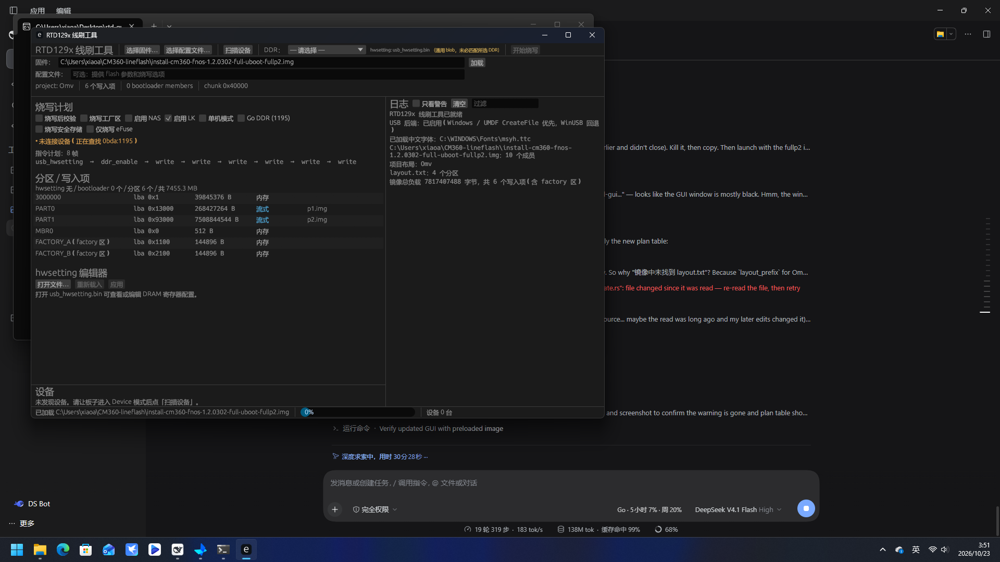

# RTD129x USB 线刷工具（64 位重写版）

[](https://github.com/xiaoabiao/rtd129x-usb-flasher/actions/workflows/build.yml)
[](https://github.com/xiaoabiao/rtd129x-usb-flasher/releases)

Realtek **RTD1295 / RTD1296**（CM360 / BPI-W2 等同芯片板子）USB 线刷工具的
**64 位 Rust 重写实现**：图形界面 + 命令行，完整还原原厂
`rtumdfsample.exe` 的 CBW/CSW 线刷协议，并且**能刷原版 32 位工具刷不了的大包**
（单文件 > 2 GB、单个成员 > 4 GB）。

> 已实测（2026-10-23）：用本工具刷写 **2.40 GB** 与 **7.82 GB**（其中 `p2.img`
> 单个成员 **7.0 GB**）的完整 `install.img`，断电重启均正常进入 fnOS。
> 刷写全程每片 256 KiB 都有 CSW 应答：29,825 帧 / 29,825 应答，零超时重试。



---

## 为什么需要它

原厂工具是 32 位程序，刷大包时会失败：

* 加载镜像阶段要按分区总大小分配虚拟内存，实测 7.8 GB 包申请
  3,745,758,720 字节直接 `GetLastError:8`（内存不足）；
* 因此只能把 rootfs 拆成 `p2a~p2d` 多个 < 2 GB 的成员才能刷。

本实现是 64 位，并且**分区按 2 MiB 一块从 tar 流式读取**，
不需要拆分、也不会把几 GB 的分区读进内存。

## 功能

* **协议完整还原**：hwsetting(0xF5) → DDR enable(0xFA) → 低区 → boot 分区 →
  rootfs 分区 → MBR → factory 区（两个副本）
* **镜像格式**：`install.img`（tar），支持 `target=` 和 cm360 用的
  `#define PARTn " offset=… name=… "` 两种 layout 写法，tar 扁平/`omv/` 布局都行
* **大包**：tar 大小/偏移全程 u64，大成员流式读取（> 2 GB、> 4 GB 实测通过）
* **factory 区**：完整复刻原厂格式（10 KiB 对齐 tar + `RTK\0` 头 + 尾部块），
  这是能启动的关键之一
* **图形界面 + 命令行**：`rtd-gui.exe` / `rtd-flash.exe`
  * `rtd-flash.exe plan  <DDR类型>` —— 干跑，打印完整帧序列，不碰设备
  * `rtd-flash.exe burn  <DDR类型>` —— 实刷
* Windows 7+，**不依赖任何运行库**（只用系统 DLL；不需要 .NET/VC++/Python）

## 下载 / 安装

到 [Releases](../../releases) 下载：

| 文件 | 说明 |
|---|---|
| `RTD-Flasher-Setup-<版本>.exe` | 安装包：双击即装（按用户安装，**不需要管理员**），自动建桌面/开始菜单快捷方式，含 hwsetting、原厂 USB 驱动包、文档 |
| `RTD-Flasher-<版本>-portable.zip` | 绿色包：解压即用（保持 `hwsetting\` 与 exe 同目录） |

**新电脑第一次用**：插上处于 USB 下载模式的板子 → 开始菜单
「RTD-Flasher → 安装 USB 驱动（管理员）」→ UAC 点“是” → 拔插板子 → 打开工具扫描设备。
（设备管理器里已经能看到 `Realtek generic USB Device` 的话，这步跳过。）

> exe 未做代码签名，SmartScreen 可能提示，点「更多信息 → 仍要运行」。

## 使用

1. 板子断电，进入 **USB 下载模式**。
2. 打开 `rtd-gui.exe`，选择 `install.img`，DDR 类型选 `4DDR4_2GB`（本板）。
3. 点「加载」，核对下方「分区 / 写入项」列表（应含低区、PARTn、MBR、FACTORY_A/B）。
4. 「扫描设备」→「开始烧写」。

烧写耗时参考：2.4 GB 约 7 分钟，7.8 GB 约 24 分钟。

命令行同样可用：

```bash
rtd-flash.exe devices                          # 列出板子
rtd-flash.exe plan  install.img 4DDR4_2GB      # 干跑
rtd-flash.exe burn  install.img 4DDR4_2GB      # 实刷
```

## 从源码构建

### GitHub Actions（推荐）

推送到 `main` 或打 `v*` 标签即自动：跑测试 → 编译 Windows release →
生成安装包与绿色包 → 上传 Artifact；打标签时自动创建 Release 并挂上两个包。
见 [`.github/workflows/build.yml`](.github/workflows/build.yml)。

### 本地

Windows（MSVC 工具链，输出在 `target\release\`）：

```powershell
cargo test --workspace
cargo build --release -p rtd-cli --features usb
cargo build --release -p rtd-gui --features usb,screenshot
powershell -ExecutionPolicy Bypass -File packaging\build-installer.ps1 -Version 1.0.0
```

WSL / Linux 交叉编译到 Windows（需要 MinGW，见 `build.sh`）：

```bash
./build.sh win
```

## 仓库结构

```
crates/rtd-core        协议、帧编码、镜像解析、factory、烧写编排
crates/rtd-cli         命令行（plan / burn / inspect / probe …）
crates/rtd-gui         图形界面（egui）
fixtures/              测试用数据（黄金日志、hwsetting、bootloader.tar）
hwsetting/             运行时 DDR 配置表（安装包/绿色包会带上）
docs/                  协议文档、逆向交接文档、参考实现、截图
packaging/             安装包脚本（Installer.cs + build-installer.ps1 + 驱动包）
tools/                 USBPcap 抓包/解析脚本（分析协议时用）
```

## 逆向要点（实现者必读）

完整协议见 [docs/PROTOCOL-zh.md](docs/PROTOCOL-zh.md)，逆向过程与坑见
[docs/HANDOFF-zh.md](docs/HANDOFF-zh.md)。几个**决定性**结论：

1. **`0xFA` DDR enable 不是空操作**：原工具在 hwsetting 的 CSW 之后先
   `Sleep(1500ms)`，再发 `opcode=0xFA type=0x06 dlen=5` 的 CBW，载荷是
   ASCII `"test\0"`，设备 1 ms 内回 PASS。不发或发早了，后续 WRITE 载荷会被
   设备拒收（NAK 数十秒 / 永远不回 CSW）。
2. **每片 256 KiB 都必须同步读 50 字节 CSW**；主机侧不要用常驻后台读线程，
   否则会和 256 KB 写抢同一个 UMDF 句柄。
3. **factory 区不是裸 tar**：`[10 KiB 对齐 tar][首块副本，尾 +0x1F8=长度、
   +0x1FC="RTK\0"、重算校验和][1024 B 0]`，写 LBA 0x1100 与 0x2100。
   U-Boot 靠 `RTK` magic 认 factory 区；镜像里的 `omv/factory.tar` 成员名
   可能已带 `tmp/factory/` 前缀，**只能补一层**。
4. **`layout.txt` 的 offset/size 必须 64 位解析**（原 32 位 `atoh` 会截断
   `PART4 offset=1620ba000` 这类 > 4 GiB 偏移）。

## 已知限制

* **NAND / NOR 烧写**：未实现（需要原厂 `nand_burner` 的坏块重映射逻辑）
* **eFuse / secure storage / keybag**：未实现（原厂工具包缺少 `GenKeyBag.exe`）
* 这些选项在界面里会明确提示“未实现”，不会静默跳过

## 免责声明 / License

* 本项目用于**自己拥有的硬件**的维护与互操作研究（固件刷写）。
* `packaging/driver/` 内的 USB 驱动包来自原厂工具包，版权归 Realtek 所有；
  仅为方便在新电脑上安装本工具而附带，请勿单独再分发。
* `docs/` 中的协议与逆向笔记由本仓库作者整理。
* 代码：MIT，见 [LICENSE](LICENSE)。
